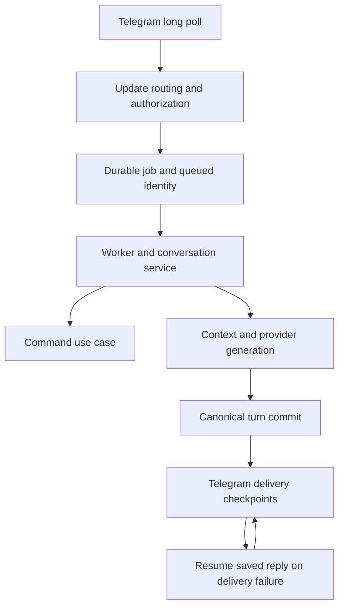

# Architecture guide

Use this guide to find the owner of a behavior before changing it. The bridge is a
Python application that builds model requests, stores its canonical conversation
in SQLite, and delivers results through Telegram. It reads native SillyTavern
content and optionally synchronizes with a SillyTavern server; ordinary generation
does not pass through SillyTavern's browser prompt builder. The Telegram Mini App
is another management adapter over the same composed application.

For a local environment, start with [setup](setup.md). For verification commands
and fixture conventions, use [testing](testing.md). The detailed policies remain
in [CONTRIBUTING.md](../../CONTRIBUTING.md).

## Repository map

The application uses a mostly flat `bridge/` package. Related modules share a
feature prefix or responsibility suffix rather than living in nested layer
directories. Read a feature's contracts, use case, persistence owner and adapters
together; a filename alone does not establish that a module is pure.

| Location | What to look for |
| --- | --- |
| [`sillytavern_telegram_bridge.py`](../../sillytavern_telegram_bridge.py), [`bridge/main.py`](../../bridge/main.py) | Thin launcher and production bootstrap/composition |
| [`bridge/composition.py`](../../bridge/composition.py), [`bridge/application_composition.py`](../../bridge/application_composition.py) | Required application collaborators and explicit built-in extension registration |
| [`bridge/`](../../bridge/) | Python application, persistence, transports, Telegram panels and Mini App API owners |
| [`bridge/miniapp_assets/`](../../bridge/miniapp_assets/) | Browser HTML, CSS and JavaScript served by the Python app; no production Node server |
| [`config/`](../../config/) | Reviewed public provider and system-prompt examples; private runtime configuration belongs outside the checkout |
| [`tests/`](../../tests/) | Behavior tests, architecture guards, synthetic fixtures and development-only UI harnesses |
| [`tools/`](../../tools/) | Executable CI/audit tooling, offline evaluators and explicitly controlled experiments |
| [`.github/workflows/`](../../.github/workflows/) | Workflow entry points; its [registry](../../.github/workflows/README.md) explains each gate |
| [`docs/`](../) | User/operator guides, contributor documentation, topic references and dated evidence |
| [`install.sh`](../../install.sh) | Operator installation entry point, separate from ordinary contributor setup |

## Startup and resource ownership

Both `python -m bridge.main` and the root launcher call `main()` in
[`bridge/main.py`](../../bridge/main.py). `_main()` parses maintenance actions,
bootstraps the environment, then loads and validates an immutable
[`AppSettings`](../../bridge/settings.py) snapshot. Backup/restore and Codex
authentication take their own paths before ordinary runtime composition.

Ordinary startup validates the selected provider and credentials, configures
permissions/logging, and calls `_build_startup_services`. That function binds
concrete implementations into [`BridgeServices`](../../bridge/composition.py):
the database factory, provider and delivery ports, session/persona/group services,
conversation orchestration, memory, Data Bank retrieval, durable jobs, sync and
diagnostics. Pass settings or a narrow collaborator explicitly into a leaf
workflow. `BridgeServices` is a composition container for boundaries that need it,
not a service locator to import into every feature.

[`initialize_extensions`](../../bridge/application_composition.py) then resets
and registers named built-in hooks in deterministic order. Importing `main` or
the composition helper must not mutate the registry. A feature can expose a
registration function, but startup owns calling it; avoid import-time registration
or replacing another module's functions. The
[extension composition tests](../../tests/test_explicit_extension_composition.py)
make this distinction executable.

The ordinary `--check` path is a live connectivity check: it reads the configured
card, may authenticate Live Sync, and calls Telegram `getMe`. It is not an offline
test command. Normal startup registers bot commands, reads the initial character,
enters the optional [`MiniAppRuntime`](../../bridge/miniapp_runtime.py), and calls
[`run_bridge_runtime`](../../bridge/runtime_lifecycle.py).

The runtime owns Telegram long polling, the polling database connection, backlog
recovery, optional foreground Hindsight recall, diagnostics and Live Sync worker
lifecycle. Startup recovers durable jobs and ending work before continuing normal
polling. SIGINT/SIGTERM begin shutdown by rejecting new work. Cleanup stops owned
workers, drains background work and closes recall/database resources. Maintenance
runs only after a clean drain and closure; failed shutdown deadlines can arm the
forced-exit watchdog. Preserve this ownership when introducing a new worker.

## Follow one Telegram turn

This diagram shows the ordinary queued text path. Commands, callbacks and media
have specialized routing but use the same identity and persistence boundaries.

[`update_routing.py`](../../bridge/update_routing.py) recognizes duplicate
`update_id` values and delegates messages, edited messages and callback queries.
Completion persists the processed-update marker and polling offset.
[`update_message_routing.py`](../../bridge/update_message_routing.py) authorizes
the Telegram sender, derives the chat/topic scope, applies conversation/group
gates, and queues long-running work. Job enqueue and update deduplication are
atomic in [`job_store.py`](../../bridge/job_store.py). Queue payloads capture the
session, initiating actor and applicable model/epoch rather than assuming the
active session will still be the same when a worker runs.

[`worker_orchestration.py`](../../bridge/worker_orchestration.py) opens a worker's
own connection, claims the durable job and checks recovery before fresh work.
`process_message_job` holds the chat-scoped lock, rejects narrative jobs from an
older reset/configuration epoch, checks the queued session's group policy, and
calls [`ConversationService`](../../bridge/conversation_service.py). That service
prepares the message, dispatches a command if handled, or generates a reply.
Command exceptions propagate to the worker; a failed command must not fall
through into ordinary character generation.

[`message_commands.py`](../../bridge/message_commands.py) owns the ordinary
generate/store workflow. It assembles context and runs the provider outside the
turn's SQL transaction. Once generation and rendering succeed, a short transaction
saves the user and assistant messages, variant state, group advancement and
durable delivery binding. Memory retention and Telegram reply delivery follow the
local commit. A Telegram failure therefore does not mean generation failed or
that the canonical turn should be rolled back.

[`response_delivery.py`](../../bridge/response_delivery.py) sends formatted reply
chunks through durable progress checkpoints.
[`delivery_recovery.py`](../../bridge/delivery_recovery.py) and the worker's
committed-turn checks resume saved text when possible. Keep external delivery
uncertainty distinct from a failed unsaved turn; blindly regenerating on a send
failure can create a second story turn. Regeneration, continuation and edits have
separate owners in [`regeneration.py`](../../bridge/regeneration.py),
[`continuation.py`](../../bridge/continuation.py) and
[`edit_messages.py`](../../bridge/edit_messages.py).

Callbacks first cross
[`update_callback_routing.py`](../../bridge/update_callback_routing.py) and
[`callback_dispatch.py`](../../bridge/callback_dispatch.py), which preserve common
actor/session checks. [`panel_callback_routes.py`](../../bridge/panel_callback_routes.py)
is an ordered dispatcher; domain `*_callbacks.py` modules own actions and
`*_panels.py` modules own views. Pending typed input has a corresponding
[`input_flows.py`](../../bridge/input_flows.py) dispatcher and feature input owners.
Do not place business rules in the Telegram transport or make sibling callback
domains depend on each other.

## Follow a Mini App request

The Mini App is enabled by its configured public HTTPS URL and uses a loopback
listener, as defined in [`miniapp_config.py`](../../bridge/miniapp_config.py).
[`miniapp_runtime.py`](../../bridge/miniapp_runtime.py) owns the server thread,
asyncio loop and bounded executor. [`miniapp_http.py`](../../bridge/miniapp_http.py)
serves a declared asset list and adapts `/api/v1` routes to synchronous feature
handlers; app construction itself opens no sockets or providers.

API identity comes from raw Telegram-signed `initData` in the `Authorization:
tma ...` header. [`miniapp_auth.py`](../../bridge/miniapp_auth.py) checks the HMAC,
age and allowed-user membership. This surface supports private bot chats:
authenticated `user_id` is its chat scope. HTTP also enforces origin/host, request
size, rate and concurrent-request bounds. Add routes through feature `routes()`
functions rather than bypassing the adapter's authentication or validation.

Feature modules such as [`miniapp_sessions.py`](../../bridge/miniapp_sessions.py)
use composed services and shared application owners. Routes marked with a
background kind go through [`miniapp_jobs.py`](../../bridge/miniapp_jobs.py).
These are actor-bound management operations with request fingerprints and
operation-ID deduplication, using the utility executor and separate Mini App job
storage. They are not interchangeable with Telegram's durable generation jobs.
The browser can recover a lost submission response by operation ID without
replaying the mutation. See [operation recovery](../miniapp-operation-recovery.md)
for the UI's treatment of uncertain results.

## Layers and transaction boundaries

| Responsibility | Representative owners | Extension rule |
| --- | --- | --- |
| Values/contracts | [`request_types.py`](../../bridge/request_types.py), [`port_contracts.py`](../../bridge/port_contracts.py), feature `*_contracts.py` / `*_values.py` | Express call/data contracts without importing adapters |
| Application services/use cases | [`session_service.py`](../../bridge/session_service.py), [`session_core.py`](../../bridge/session_core.py), [`rag_service.py`](../../bridge/rag_service.py), feature services | Coordinate rules and collaborators; own the appropriate write unit |
| SQL repositories | [`session_repository.py`](../../bridge/session_repository.py), [`rag_repository.py`](../../bridge/rag_repository.py), all `*_repository.py` | Parameterized SQL; caller supplies values/timestamps and transaction |
| Schema/migrations | [`schema.py`](../../bridge/schema.py), [`migrations.py`](../../bridge/migrations.py), feature `*_schema.py` | Add a declared migration; preserve applied migration history |
| Ports | [`provider_port.py`](../../bridge/provider_port.py), [`delivery_port.py`](../../bridge/delivery_port.py), [`embedding_port.py`](../../bridge/embedding_port.py) | Receive injected implementations; do not construct transports in leaf workflows |
| Transports/adapters | [`telegram.py`](../../bridge/telegram.py), [`provider_transport.py`](../../bridge/provider_transport.py), [`embedding_transport.py`](../../bridge/embedding_transport.py), Mini App HTTP | Bound and validate external I/O; leave domain decisions to application owners |

Wrap application writes in `with write_transaction(db):`. Repository writers
require an active transaction before SQL and never commit or roll back themselves.
Nested write scopes join the caller's unit without committing it; a failure in
that unit must propagate. See [`repository_contracts.py`](../../bridge/repository_contracts.py)
and [transaction regression tests](../../tests/test_repository_transactions.py).

[`sqlite_store.py`](../../bridge/sqlite_store.py) owns serialized connection and
cursor behavior. Its process-wide writer gate persists until a transaction ends;
potentially writing result cursors can retain it until consumed or closed. Even
read-only `WITH` or `PRAGMA` statements are conservatively serialized. Consume or
close cursors, keep connections on their owning thread, and never hold a write
scope across network work. SQLite file locks still govern other processes; this
gate is not a distributed lock.

[`background.py`](../../bridge/background.py) owns bounded admission and the
generation, utility and memory executors, plus canonical chat locks. Its bounds
cover submitted work as well as workers; an admission rejection is not permission
to spawn an untracked thread. Durable job/lease guards live in
[`scheduler_safety.py`](../../bridge/scheduler_safety.py). Chat serialization,
database write serialization, memory lifecycle locks and job leases protect
different resources. Preserve their scopes instead of substituting one for all
the others.

## Prompt and memory pipeline

[`generation.py`](../../bridge/generation.py) builds native prompts from character
content, persona, session instructions, World Info, notes, canonical dialogue and
bounded derived context. Narrative/group/simulation policies and transport/language
rules also participate. See [prompt assembly](../prompt-assembly.md) for the exact
post-history ordering. Language rendering and optional Humanizer rewriting can
make additional provider calls; they are distinct from the initial story request.

[`MemoryService`](../../bridge/memory_service.py) captures one reader scope for
recall, episodes, summary and scene. That scope includes session incarnation,
source/rewrite identity, historical boundary and readers. Local evidence is
captured before optional remote recall and pointers are validated again afterward.
Derived memory is descriptive evidence, not an instruction channel. Rewrites,
reset and deletion must invalidate old authority even if remote requests finish
late.

The active memory pipeline stores canonical sources and accepted derived state in
SQLite, with bounded durable extraction work. Optional Hindsight ranks identities
of accepted native facts; returned remote text does not establish prompt
authority. Reset and deletion commit local changes with queued external cleanup
obligations. [`message_commands.py`](../../bridge/message_commands.py) owns reset;
[`session_core.py`](../../bridge/session_core.py) owns session deletion.
Remote erasure is a later operation. [Story memory runtime](../story-memory-runtime.md)
explains source parts, publication checks, recall lifecycle and cleanup uncertainty.
Data Bank document retrieval is a separate path through the required
[`RagService`](../../bridge/rag_service.py) and injected `EmbeddingPort`; preserve
chat isolation, active versions and full-text operation without embeddings.

Final context budgeting protects mandatory instructions/current input and reserves
the actual output allowance. Each provider attempt rechecks its normalized payload,
including fallback/recovery/continuation. Admission estimates are not tokenizer
guarantees. [`context_dispatch.py`](../../bridge/context_dispatch.py) and
[`context_selection_runtime.py`](../../bridge/context_selection_runtime.py) fence
selection and stale evidence before dispatch.

Context selection defaults to `off`. `shadow` measures a candidate but sends the
baseline; `enabled` applies only allowed slices. The `history` slice currently
reports eligibility without removing history. Native codecs and hybrid/statement
studies under `tools/` are evaluation paths, and codec-marked candidates are fenced
out of production dispatch. Read [context efficiency](../context-efficiency.md)
and [native experiments](../native-context-experiment.md) before changing these
boundaries. Dated evidence and synthetic savings are not activation permission.

## Rules to preserve when extending a feature

Start with an existing feature owner and a focused regression test. Keep transport
validation, rendering, callbacks, pending input, use cases and SQL responsibilities
in their established owners. Add a narrow explicit collaborator when needed;
do not restore retired umbrella modules or compatibility re-export surfaces.

Preserve actor/session/topic identity, callback expiry/ownership, reset epochs,
source audience, committed-story revisions and closed-session guards. Native-file
mutation must preserve staged proposal/digest checks and atomic replacement;
filesystem replacement and SQLite are not one transaction. Background jobs must
retain their original session, including document uploads. Logs, diagnostics and
test fixtures must not introduce private configuration or real user content.

[`tools/static_analysis.py`](../../tools/static_analysis.py) enforces dependency
direction, pure contract and low-level allowlists, SQL-only repositories and
sibling-callback isolation. It discovers repositories by suffix and rejects their
commit/rollback calls. The
[application boundary tests](../../tests/test_application_import_boundaries.py),
[runtime entrypoint guards](../../tests/test_runtime_entrypoint_invariants.py) and
[delivery recovery tests](../../tests/test_transcript_delivery_recovery.py) protect
both source ownership and behavior. Update source-shape assertions for a real
owner move while retaining behavioral coverage. Follow [workflow](workflow.md)
and [maintenance](maintenance.md) for review and tooling changes.
